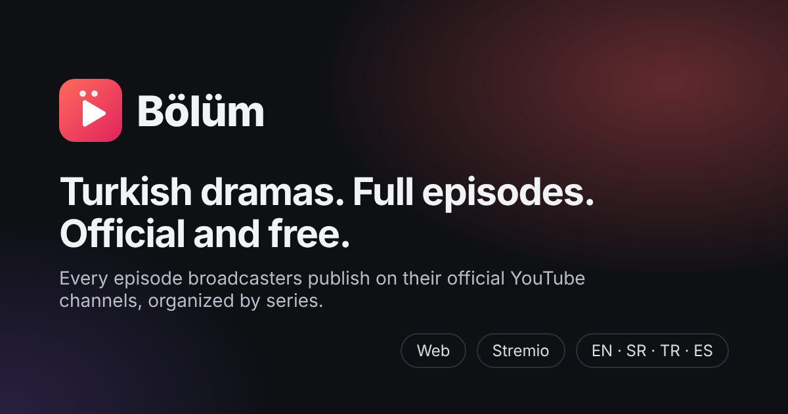

<div align="center">



# Bölüm

**Every full episode of Turkish dramas that broadcasters publish for free on their official YouTube channels, organized by series.**

Website · Stremio addon · English · Srpski · Türkçe · Español

</div>

---

Turkish broadcasters upload thousands of full episodes to YouTube for free, often with
subtitles. They are scattered across hundreds of playlists and mixed with trailers,
clips and recaps, so fans end up on sketchy pirate sites instead.

Bölüm fixes that. It finds the full episodes on official channels, groups them by
series and episode number, and gives you a clean place to watch them.

## Features

- **Series, not videos.** Episodes are grouped by series and season, in order, with
  trailers, clips, recaps and shorts filtered out.
- **Continue watching.** Bölüm remembers where you stopped, resumes from there and
  marks finished episodes.
- **Autoplay next episode**, with a countdown you can cancel.
- **My list**, search that ignores Turkish letters (`yali capkini` finds `Yalı Çapkını`),
  and filters by channel.
- **Stremio addon** with the same catalog.
- **Four languages**: English, Serbian, Turkish and Spanish, picked from your browser.
- **Search engine friendly.** Every series has its own page with structured data, so
  people searching for a show can find it.
- **No accounts, no ads, no tracking.** Your progress stays in your browser.
- **No servers.** It runs on GitHub Pages and GitHub Actions for free.

## Legal by design

- Only **official** channels of broadcasters and production companies are included,
  and a person confirms each one (see `katalog/kanali.json`).
- Videos play in **YouTube's own embedded player**, so views count for the owners,
  their ads run, and their geo restrictions apply.
- Nothing is downloaded, re-hosted or scraped. Data comes from the official
  [YouTube Data API](https://developers.google.com/youtube/v3) and is refreshed daily.
- Bölüm is not affiliated with YouTube or any broadcaster.

## Stremio

In Stremio, open **Add-ons**, paste the addon address into the search field and install it:

```
https://<your-site>/stremio/manifest.json
```

The website footer has a one-click **Add to Stremio** button and a button that copies
the address.

## How it works

```
katalog/kanali.json ── confirmed official channels
        │
        ▼  scripts/osvezi.mjs (daily, GitHub Actions, YouTube Data API)
data/katalog.json ──── episodes: series, season, number, duration, subtitles
        │
        ▼  scripts/napravi.mjs
dist/ ──────────────── website + one page per series + Stremio addon (static JSON)
        │
        ▼  GitHub Pages
```

- **Episode detection** (`src/epizode.mjs`) reads titles such as `Series 45. Bölüm`,
  `Series Episode 45`, `Capítulo 45` or `الحلقة 45`, and rejects trailers, clips,
  recaps and anything shorter than 20 minutes.
- **Refreshing** (`src/katalog.mjs`) reads a channel's uploads from newest to oldest
  and stops at the first video it has already seen, so a daily run uses a few dozen
  of the 10,000 free API units. Once a week it rescans everything to drop deleted
  videos.
- **The website** (`sajt/`) is plain HTML, CSS and JavaScript modules with no build
  step and no dependencies. It has a strict Content Security Policy.

## Run it locally

Requires Node.js 22 or newer. There are no dependencies to install.

```bash
npm test          # all tests
npm run primer    # build with demo data, then open http://localhost:8080
```

The demo catalog in `test/primer-katalog.json` uses invented series and channel names.

With your own YouTube API key:

```bash
YOUTUBE_API_KEY=... npm run osvezi   # refresh data/katalog.json
npm run napravi && npm run pokreni   # build and preview
```

## Suggest a channel

Open an issue or a pull request that adds the channel to `katalog/kanali.json` with
`"potvrdjeno": false`. Include a link that shows the channel is official, such as the
broadcaster's website linking to it. A maintainer verifies it and turns it on.

## Project structure

| Path | Purpose |
| --- | --- |
| `katalog/kanali.json` | Official channels and their language and subtitles |
| `src/` | Episode detection, YouTube client, catalog refresh, Stremio, HTML pages |
| `scripts/` | `osvezi` (refresh), `napravi` (build), `server` (local preview) |
| `sajt/` | The web app |
| `test/` | Tests (`npm test`) and demo data |
| `.github/workflows/` | Tests, daily refresh and publishing |
