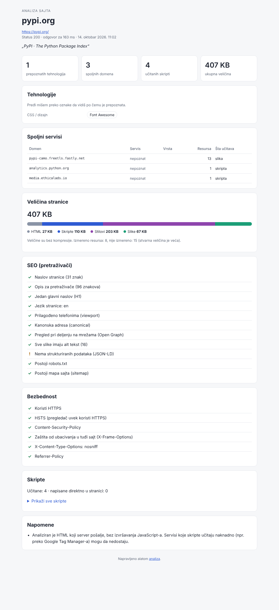

# Analiza sajta

Alat koji za bilo koji sajt pokaže **od čega je napravljen i šta učitava**:

- **tehnologije**: WordPress, Shopify, Next.js, React, jQuery, Cloudflare…, sa verzijom kad se vidi i sa dokazom po kom je tehnologija prepoznata
- **WordPress detalji**: koja tema i koji dodaci (pluginovi) se koriste
- **skripte**: koliko ih ima i odakle dolaze
- **spoljne servise**: analitiku, reklame, video plejere, fontove, chat i drugo
- **veličinu stranice**: HTML, skripte, stilovi i slike
- **SEO**: naslov, opis, H1, Open Graph, alt tekst na slikama, robots.txt, sitemap
- **bezbednosna zaglavlja**: HTTPS, HSTS, CSP, X-Frame-Options i da li server otkriva verziju softvera

Rezultat se ispiše u terminalu i sačuva kao pregledan HTML izveštaj.



```text
$ node analiza.mjs nodejs.org

Sajt:   nodejs.org
Adresa: https://nodejs.org/en (status 200, odgovor za 431 ms)
Naslov: Node.js — Run JavaScript Everywhere

TEHNOLOGIJE
  JavaScript okvir: Next.js, React
  Hosting / CDN:    Cloudflare, Vercel

SKRIPTE
  Učitane: 18 (sa drugih domena: 0) · napisane u samoj stranici: 10
...
Izveštaj sačuvan: izvestaji/nodejs.org.html
```

## Pokretanje na svom računaru

1. Instaliraj [Node.js](https://nodejs.org/) verziju 22 ili noviju (izaberi „LTS“).
2. Preuzmi ovaj kod: zeleno dugme **Code → Download ZIP**, pa raspakuj. Ili preko git-a:
   ```bash
   git clone https://github.com/srbinzaprimer/analiza.git
   cd analiza
   ```
3. U folderu projekta jednom pokreni:
   ```bash
   npm install
   ```
4. Analiziraj sajt:
   ```bash
   node analiza.mjs primer.rs
   ```
5. Otvori izveštaj iz foldera `izvestaji/` (npr. `izvestaji/primer.rs.html`) u pregledaču.

Može i više sajtova odjednom: `node analiza.mjs prvi.rs drugi.com`.

### Opcije

| Opcija | Šta radi |
| --- | --- |
| `--json` | Ispisuje ceo rezultat kao JSON (za dalju obradu) |
| `--bez-html` | Ne pravi HTML izveštaj |
| `--bez-merenja` | Ne preuzima skripte, stilove i slike radi merenja veličine (brže) |
| `--izlaz <folder>` | Gde se čuvaju HTML izveštaji (podrazumevano `izvestaji`) |
| `-h`, `--pomoc` | Pomoć |

## Pokretanje preko GitHub-a, bez instalacije

1. Na stranici repozitorijuma otvori karticu **Actions**.
2. Levo izaberi **Analiziraj sajt**, pa klikni **Run workflow**.
3. Upiši adresu sajta i potvrdi.
4. Kad se završi, otvori pokretanje: rezultat je odmah prikazan na stranici (**Summary**), a HTML izveštaj možeš da preuzmeš pod **Artifacts → izvestaj**.

## Kako radi

1. Preuzme stranicu kao što to radi pregledač.
2. Pročita HTML: skripte, stilove, slike, iframe-ove i meta oznake.
3. Uporedi ono što je našao sa potpisima poznatih tehnologija u [`src/tehnologije.mjs`](src/tehnologije.mjs). Potpis je, na primer, `/wp-content/` u HTML-u za WordPress ili zaglavlje `cf-ray` za Cloudflare.
4. Preuzme skripte, stilove i slike da izmeri veličinu stranice.
5. Proveri SEO oznake, `robots.txt`, sitemap i bezbednosna zaglavlja.

| Fajl | Uloga |
| --- | --- |
| `analiza.mjs` | Komanda koju pokrećeš |
| `src/analizator.mjs` | Glavna analiza stranice |
| `src/tehnologije.mjs` | Potpisi tehnologija i servisa |
| `src/preuzimanje.mjs` | Preuzimanje sa ograničenjem vremena i veličine |
| `src/izvestaj*.mjs` | Tekstualni i HTML izveštaj |
| `test/` | Testovi (`npm test`) |

### Dodavanje nove tehnologije

U [`src/tehnologije.mjs`](src/tehnologije.mjs) dodaj pravilo u listu `PRAVILA`:

```js
{
  ime: "Moj CMS",
  kategorija: K.cms,
  generator: [/MojCMS\s*([\d.]+)?/i], // prva grupa u zagradi je verzija
  html: [/\/mojcms-assets\//],
  domeni: ["cdn.mojcms.com"],
},
```

Zatim dodaj primer u `test/analiza.test.mjs` i pokreni `npm test`.

## Ograničenja

- Alat čita HTML koji server pošalje i **ne izvršava JavaScript**. Zato ne vidi sadržaj koji sajt iscrtava tek u pregledaču (SPA) ni servise koje skripte učitaju naknadno, npr. preko Google Tag Manager-a. Izveštaj upozori kad je to verovatno slučaj.
- Prepoznavanje se zasniva na potpisima, pa neku tehnologiju može da propusti, a retko i da pogrešno prepozna.
- Veličine su merene bez kompresije, a meri se najviše 60 skripti, 30 stilova i 40 slika.
- Neki sajtovi (npr. iza Cloudflare zaštite) blokiraju automatske alate. Izveštaj tada to i navede.

## Odgovorna upotreba

Alat preuzima samo ono što javno dobija svaki posetilac sajta i ne zaobilazi nikakvu zaštitu. Koristi ga za učenje, proveru svojih sajtova i upoređivanje. Poštuj uslove korišćenja sajtova koje analiziraš i ne koristi ga za masovno preuzimanje sadržaja.
